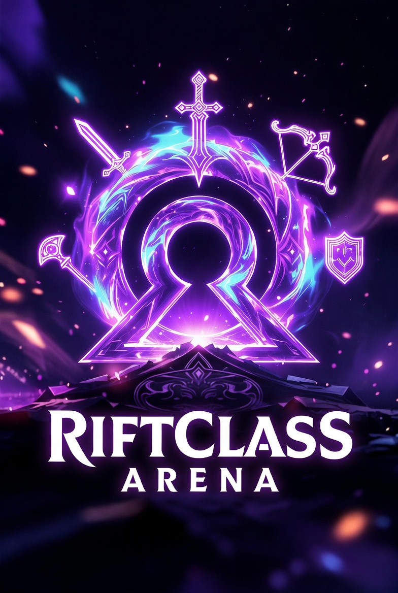

# Riftclass Arena

An isometric arena roguelite for mobile, built with Flutter and the Flame game engine. Pick one of four classes, fight through waves of enemies across three worlds, and grow stronger by choosing ability upgrades between waves.



## Gameplay

- **Four classes**, each with three abilities that can be upgraded up to level 5:

| Class | Abilities |
| --- | --- |
| Archer | Multi-Shot, Piercing Arrow, Arrow Rain |
| Mage | Frost Nova, Chain Lightning, Meteor |
| Warrior | Shield Bash, Whirlwind, Leap Slam |
| Necromancer | Summon Skeleton, Life Drain, Corpse Explosion |

- **Three worlds**, each with its own enemies and boss:

| World | Enemies | Boss |
| --- | --- | --- |
| Forsaken Castle | Skeleton, Bat, Spider | Death Knight |
| Shadow Abyss | Dark Mage, Bat, Imp | Shadow Dragon |
| Cursed Forest | Spider, Golem, Skeleton | Death Knight |

- **10 levels per world, 5 waves per level.** The last wave of each level is a boss wave, and in harder levels the boss brings minions. Difficulty scales with the world, the level and the wave.
- **Portals and upgrades**: clearing a wave opens an animated dark portal. Stepping into it brings up the ability-select screen, and then the next wave starts.
- **Auto-attack**: the hero attacks automatically while standing still, so movement is the main decision, Archero-style.
- **Healing**: completing a level restores the player's health.
- **Progression**: the highest cleared level per world is saved on the device, and a world unlocks when the previous one is fully completed.

## Features

- **Floating joystick**: touch anywhere and the joystick appears under your finger. It disappears when you let go.
- **Chibi player** with squash-and-stretch animation, drawn with custom painters (also used for the class previews on the class-select screen).
- **Smooth follow camera** with trauma-based screen shake.
- **Layered VFX**: hit sparks, floating damage numbers, dust and shockwaves.
- **Screens**: main menu, class select, world select and the game, with pause, game-over and ability-select overlays.
- **Offline**: no backend, no account and no ads.

## Tech stack

| Area | Technology |
| --- | --- |
| Framework | Flutter, Dart 3 |
| Game engine | Flame |
| Persistence | `shared_preferences` |
| Graphics | Flame components and custom `Canvas` painting (no sprite sheets) |

## Project structure

```
lib/
  main.dart                     App entry point and dark theme
  game/
    riftclass_game.dart         FlameGame: world, camera, overlays, pause, game flow
    config.dart                 Tuning constants
    components/
      player.dart               Movement, auto-attack, abilities, animation
      enemy.dart                Enemy behavior and bosses
      projectile.dart           Arrows, spells and enemy shots
      room.dart                 Isometric arena
      room_manager.dart         Worlds, levels, waves, difficulty scaling
      dark_portal.dart          Wave-clear portal
      effects.dart              Sparks, damage numbers, dust, shockwaves
      floating_joystick.dart    Touch joystick
      hud.dart                  Health bar with damage trail, world and room info, score
  models/                       Player classes, enemy types, world themes
  services/
    progression_service.dart    Saved progress and world unlocking
  screens/                      Main menu, class select, world select, game
  overlays/                     Pause, game over, ability select
  widgets/                      Class character painter and preview
test/
  widget_test.dart              App smoke test
```

## Getting started

Requirements: the Flutter SDK (Dart 3.11+) and an Android or iOS device or emulator.

```bash
flutter pub get
flutter run
```

## Tests

```bash
flutter test
```
